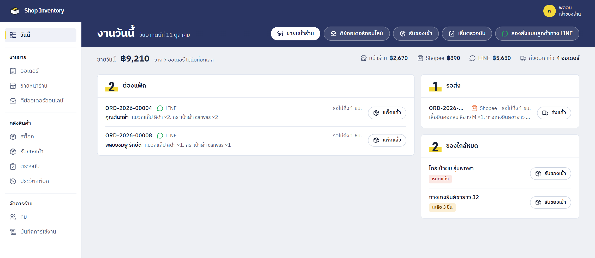
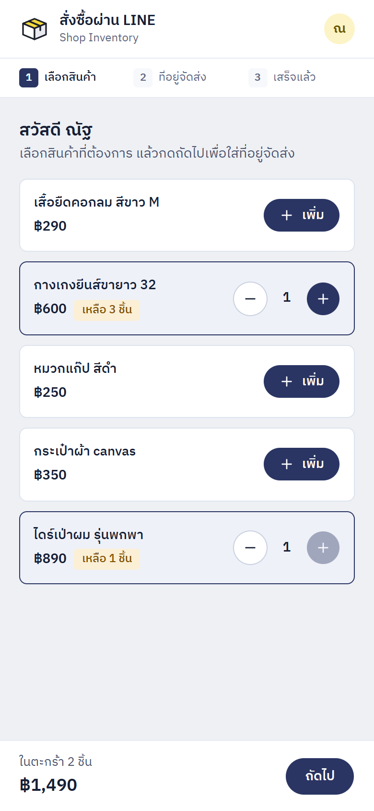
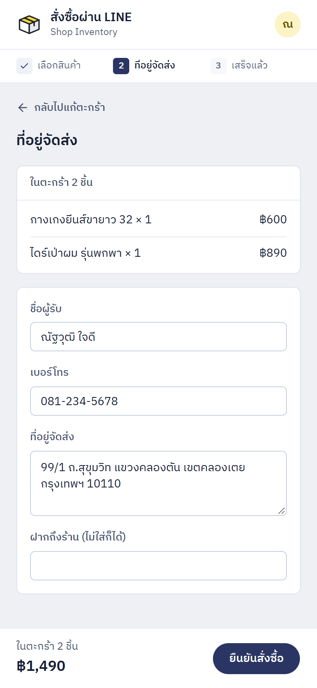
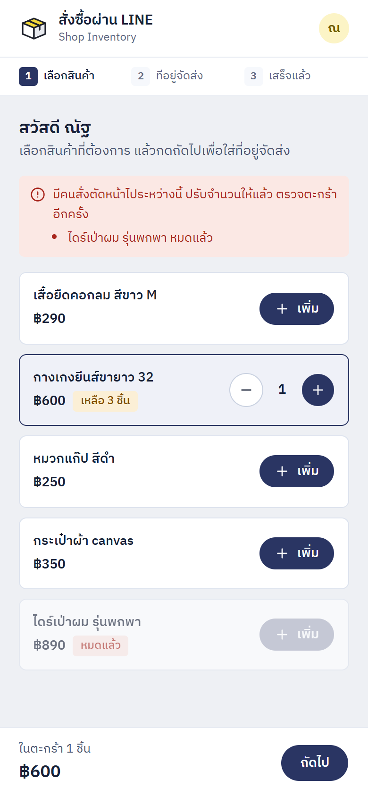
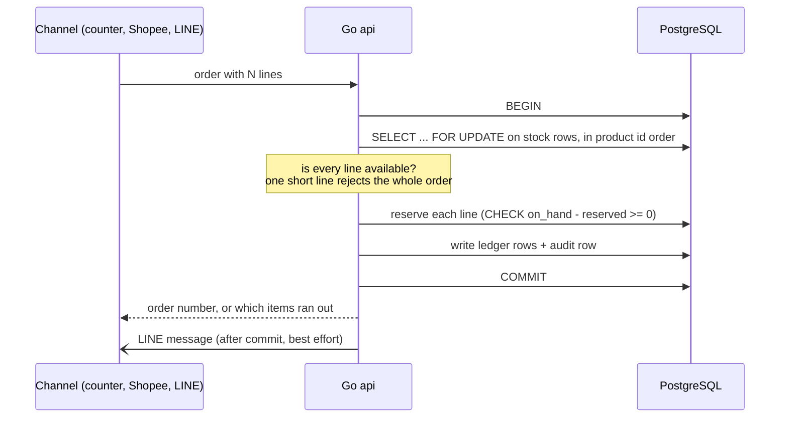
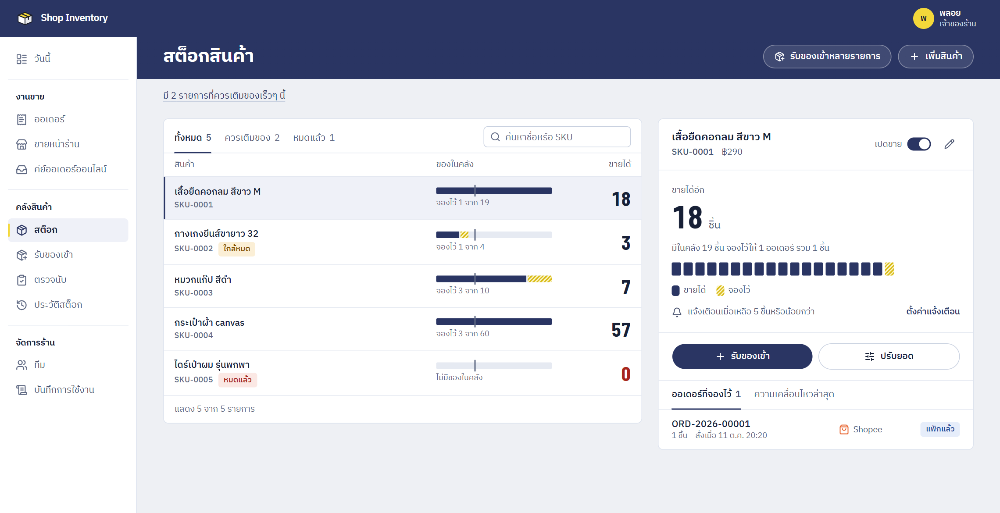
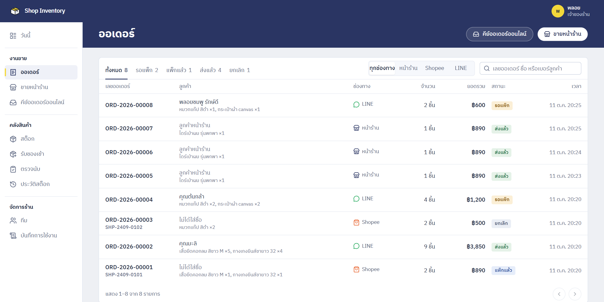
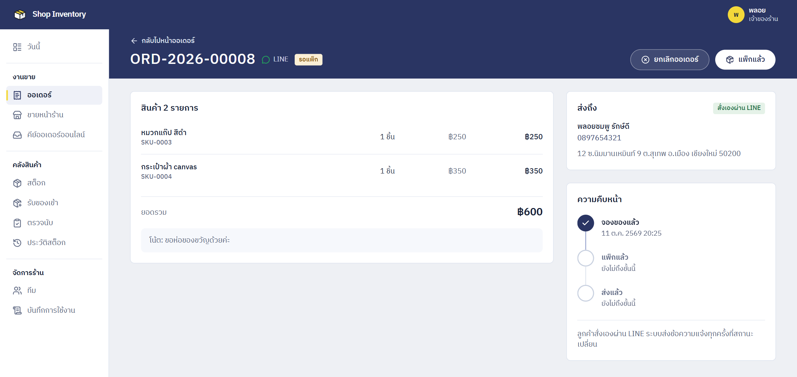
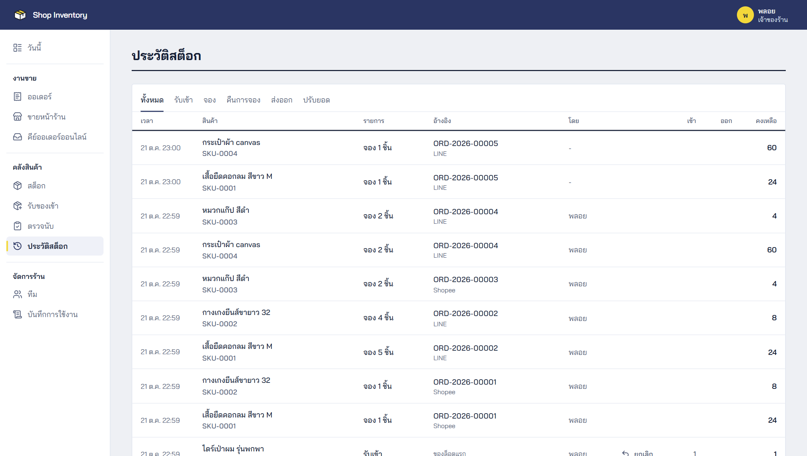

# shop-inventory-app

[](https://github.com/aumputthipong/shop-inventory-app/actions/workflows/ci.yml)
[](https://turtle-shop.onrender.com)


<!-- TODO: CodeQL badge (no CodeQL workflow yet) -->
<!-- TODO: License badge (no LICENSE file yet) -->
<!-- TODO: Coverage badge (coverage is not reported yet) -->

A back office for a small shop that sells **one pool of stock** through its
counter, Shopee and LINE, built so that two customers can never buy the same
last unit.



## Try it

**<https://turtle-shop.onrender.com>** (free hosting: the first load after a
quiet spell takes about a minute)

| Role | Email | Password | Can do |
|---|---|---|---|
| Owner | `owner@demo.shop` | `demo-owner-2026` | Everything |
| Staff | `staff@demo.shop` | `demo-staff-2026` | Orders, packing, receiving, counting |

Order as a customer in LINE: **<https://liff.line.me/2011822094-skUIRf13>**
(open it on a phone). The sample data is reset from time to time.

**Things worth trying**

- **Race yourself for the last unit:** put the hair dryer in your LINE cart,
  sell it at the counter (ขายหน้าร้าน), then confirm in LINE.
- **Follow a LINE order:** pack and ship it; the customer gets a message at
  each step.
- **Undo a mistake:** receive 50 of something, then undo it in ประวัติสต็อก.
- **Count as staff, approve as owner:** the difference becomes a ledger row.

## The problem

When three channels sell the same 5 units, two customers can buy "the last
one" at the same moment. Here every order **reserves** stock first, then
**ships** or is **canceled**, and `available` is derived, never stored:

```
available = on_hand - reserved        -- the database refuses anything below 0
```

| Cart in LINE | Delivery details | Someone was faster |
|---|---|---|
|  |  |  |

Every channel takes the same path:



## Tech stack

| Layer | Choice | Role here |
|---|---|---|
| API | Go + Gin | HTTP only; lint rules keep gin out of the business logic |
| Data | PostgreSQL 17, pgx, sqlc, golang-migrate | Row locks and a `CHECK` constraint stop overselling; SQL compiles to typed Go |
| Frontend | React 19, Vite, TypeScript | One app for the back office and the LINE order form |
| Routing and data | TanStack Router + Query | Session check before a page renders, caching and refetch after each change |
| UI | Tailwind CSS 4 + shadcn/ui | Tokens and rules in [docs/DESIGN.md](docs/DESIGN.md) |
| Customer channel | LINE LIFF + Messaging API | Customers order inside LINE and get status messages |
| Delivery | Docker, Render, Neon, GitHub Actions | One image, one origin; lint, tests and image build on every PR |

## App shell

```
+--------------------------------------------------------------+
| [box] Shop Inventory                         (avatar) name   |  top bar
+----------------+---------------------------------------------+
| Today          |  Page title                [action][action] |  page band
| SALES          |---------------------------------------------|
|   Orders       |   list / table           |  detail panel    |
|   Counter sale |                          |                  |
|   Online order |                          |                  |
| STOCKROOM      |                          |                  |
|   Stock        |                          |                  |
|   Receive      |                          |                  |
|   Counts       |                          |                  |
|   Ledger       |                          |                  |
| SHOP (owner)   |                          |                  |
|   Team, Audit  |                          |                  |
+----------------+---------------------------------------------+
```

The app labels are Thai. On a phone the sidebar becomes a drawer.

<details>
<summary>Routes</summary>

```
/login                  sign in
/line                   LINE customer order form (public, no back-office shell)
/                       today: orders to pack and ship, low stock, counts to approve
/orders                 all orders, by status and channel, searchable by customer
/orders/new             counter sale
/orders/online          key in a Shopee or LINE chat order
/orders/:id             one order: lines, ship-to, progress, pack/ship/cancel
/stock                  balances with what is reserved, product panel
/receive                receive a whole delivery note
/counts, /counts/new    stock counts: staff submit, owner approves
/ledger                 every stock movement with the balance after it
/team, /audit           owner only: accounts and the audit log
```

</details>

## Code worth reading

- **Two guards against overselling.** Rows are locked in product id order
  ([`stock.Lock`](backend/internal/stock/ledger.go)) so orders queue instead of
  deadlocking, and a `CHECK` constraint catches any code path that forgets.
- **All or nothing, every shortage at once.**
  [`PlanReservation`](backend/internal/orders/service.go) is a plain, unit-tested
  function that rejects the whole order and lists every short line.
- **A ledger that always explains the balance.** Nothing is edited; a mistake
  is undone by an opposite entry, and a unique index stops a double undo
  ([`reverse.go`](backend/internal/stock/reverse.go)).
- **LINE is trusted only after checking.** The api verifies the customer's ID
  token ([`client.go`](backend/internal/line/client.go)) and sends messages
  after commit, so a slow LINE never cancels a sale.

**Proven under load:**
[`oversell_integration_test.go`](backend/internal/orders/oversell_integration_test.go)
fires 40 concurrent orders at 5 units against a real postgres. Exactly 5
succeed, nothing goes negative, and replaying the ledger rebuilds the balance.

More reasoning: [docs/CODE-NOTES.md](docs/CODE-NOTES.md).

## Screens









## Getting started

Only Docker is needed:

```sh
cp .env.example .env               # set POSTGRES_PASSWORD and the SEED_* accounts
docker compose --profile app up -d --build
docker compose --profile app run --rm -e SEED_SAMPLE_DATA=false --entrypoint /app/seed app
```

Open `http://localhost:8080` and sign in with the `SEED_*` accounts.

<details>
<summary>Developing with hot reload</summary>

Needs Go 1.25+ (the Makefile fetches go1.26.8), Node 22.12+, Docker, GNU make
(Windows: `scoop install make`), the
[golang-migrate](https://github.com/golang-migrate/migrate) CLI, and
optionally [sqlc](https://sqlc.dev) and
[golangci-lint](https://golangci-lint.run) v2.

```sh
cp .env.example .env
cd backend
make up && make migrate-up
make seed          # dev accounts and sample stock, empty database only
make run           # api on HTTP_PORT

cd frontend        # second terminal, from the repo root
npm install
npm run dev        # http://localhost:5173
```

`/line` runs without a LINE account in dev: open `/line?as=ploy` and
`/line?as=nat` side by side and race for the hair dryer. Real LINE setup:
[docs/LINE-SETUP.md](docs/LINE-SETUP.md).

Checks (CI runs the same on every PR):

```sh
(cd backend && make test && make test-integration && make lint)
(cd frontend && npm run lint && npm run typecheck && npm test && npm run build)
```

</details>

## Production and security

- **Sessions, not JWTs:** an `HttpOnly`, `SameSite=Lax`, `Secure` cookie whose
  token is stored only as a hash, so logout and disabling a member work at once.
- **No account enumeration:** login takes the same time whether the email
  exists or not.
- **Roles checked on the server**, on every owner-only route.
- **One origin:** the api serves the frontend, so there is no CORS to get
  wrong.
- **Safe deploys:** migrations run before the app starts, `/healthz` answers
  503 without a database, and LINE's fake dev sign-in refuses to run in
  production.

HTTPS is terminated by Render ([docs/DEPLOY.md](docs/DEPLOY.md)); self-hosted,
put it behind HTTPS and set `COOKIE_SECURE=true`.

<!-- TODO: security headers (CSP, X-Frame-Options, Referrer-Policy, HSTS) are not set yet -->

## Project layout

```
api/openapi.yaml    API contract
backend/            Go api, migrations, sqlc queries and generated code
frontend/           React app
docs/               Code notes, design system, deploy and LINE setup
```

Conventions and architecture rules: [CLAUDE.md](CLAUDE.md).
